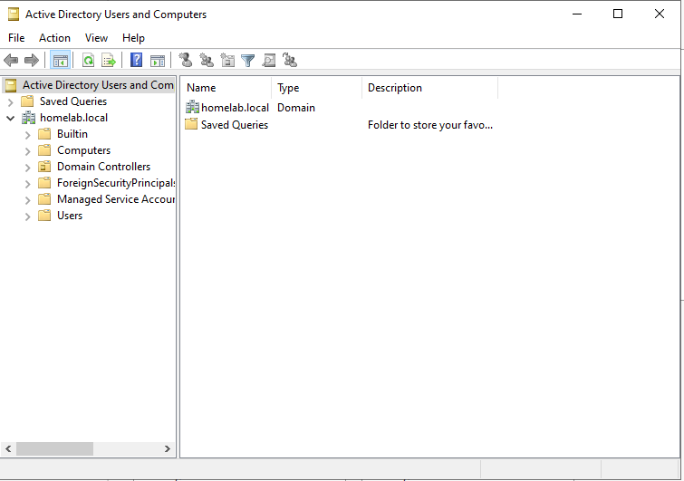

# Windows Server & Active Directory Homelab (`homelab.local`)

Domowe laboratorium sieciowe zbudowane od podstaw w celu przećwiczenia codziennych zadań administracyjnych i wsparcia użytkowników w środowisku domenowym Windows (pod kątem pracy na stanowisku **IT Helpdesk / IT Support**).
---
## Cel projektu i wykorzystane narzędzia
Głównym założeniem projektu było stworzenie odizolowanego środowiska testowego odwzorowującego małą infrastrukturę firmową, w której można bezpiecznie przetestować konfigurację kontrolera domeny, usługę DNS, zarządzanie kontami użytkowników oraz dołączanie stacji roboczych.

**Wykorzystane technologie i komponenty:**
* **Oracle VirtualBox** – środowisko wirtualizacji, w którym postawiłem dwie maszyny wirtualne spięte w wewnętrzną sieć lokalną (*Internal Network*).
* **Windows Server 2022 (`DC-LAB`, `192.168.56.10`)** – serwer pełniący rolę kontrolera domeny (AD DS) oraz głównego serwera DNS.
* **Windows 10 (`W10-LAB`, `192.168.56.11`)** – stacja kliencka skonfigurowana do pracy w domenie `homelab.local`.
---
## Przebieg prac – krok po kroku
---
### Etap 1: Przygotowanie maszyn wirtualnych i sieci
1. Zainstalowałem **Windows Server 2022** na pierwszej maszynie wirtualnej (`DC-LAB`) oraz **Windows 10** na drugiej (`W10-LAB`).
2. Skonfigurowałem karty sieciowe obu maszyn w trybie sieci wewnętrznej w VirtualBoxie oraz przypisałem im statyczną adresację IP w podsieci `192.168.56.0/24` (kontroler domeny otrzymał adres `192.168.56.10`, a stacja robocza `192.168.56.11` ze wskazaniem DNS na `192.168.56.10`).
---
### Etap 2: Konfiguracja Active Directory i struktury domeny
#### 1. Instalacja AD DS i utworzenie domeny `homelab.local`
Po zainstalowaniu roli **Active Directory Domain Services (AD DS)** oraz **DNS Server** na `DC-LAB` promowałem maszynę do roli kontrolera nowej domeny `homelab.local`:

#### 2. Organizacja struktury jednostek organizacyjnych (OU)
Aby zachować przejrzystość spotykaną w środowiskach firmowych i ułatwić późniejsze delegowanie uprawnień oraz przypisywanie polityk grupowych (GPO), utworzyłem nadrzędną jednostkę organizacyjną `Corp` i podzieliłem ją na trzy kontenery: `Users`, `Groups` oraz `Workstations`:

#### 3. Utworzenie konta użytkownika i grupy bezpieczeństwa
W kontenerze `Corp/Users` założyłem konto domenowe (`Jacek Ciuk`), a następnie przypisałem je do utworzonej w `Corp/Groups` grupy bezpieczeństwa `IT-Support` – zgodnie z dobrą praktyką nadawania uprawnień przez grupy zamiast pojedynczych kont:

---
### Etap 3: Podłączenie stacji klienckiej Windows 10 (`W10-LAB`) do domeny
#### 1. Weryfikacja łączności sieciowej i DNS
Przed dołączeniem klienta do domeny sprawdziłem komunikację z kontrolerem (`192.168.56.10`) za pomocą polecenia `ping` oraz poprawność rozwiązywania nazwy domeny `homelab.local` przez `nslookup`:

#### 2. Dołączenie stacji `W10-LAB` i przeniesienie do `Corp/Workstations`
Po zmianie nazwy hosta na `W10-LAB` i wpięciu maszyny w domenę `homelab.local` przeniosłem obiekt komputera z domyślnego kontenera `Computers` do jednostki organizacyjnej `Corp/Workstations`:

#### 3. Test logowania kontem domenowym
Po restarcie stacji roboczej zalogowałem się na konto domenowe `homelab\jacekciuk` i zweryfikowałem poprawność kontekstu użytkownika (`whoami`) oraz przynależność stacji do domeny (`systeminfo`):

---
### Etap 4: Resetowanie hasła i wymuszenie zmiany przy logowaniu
W konsoli **Active Directory Users and Computers** (`Corp/Users`) zresetowałem hasło dla konta `Jacek Ciuk` z zaznaczoną opcją **User must change password at next logon**[cite: 11]:
[cite: 11]
Po wpisaniu hasła tymczasowego na stacji `W10-LAB` system wymusił ustawienie nowego hasła przed zalogowaniem na pulpit[cite: 12]:
[cite: 12]
---
### Etap 5: Polityka blokady konta i obsługa blokady przez Helpdesk
#### 1. Konfiguracja progu blokady w Default Domain Policy
W **Default Domain Policy** (`Computer Configuration -> Policies -> Windows Settings -> Security Settings -> Account Policies -> Account Lockout Policy`) ustawiłem próg **3 nieudanych prób logowania** (*Account lockout threshold = 3*) z automatycznym czasem blokady i resetu licznika na 30 minut[cite: 13]:
[cite: 13]
#### 2. Blokada konta na stacji roboczej po błędnych próbach logowania
Po trzykrotnym podaniu błędnego hasła dla konta `Jacek Ciuk` na `W10-LAB` system zablokował dalsze logowanie[cite: 14]:
[cite: 14]
#### 3. Odblokowanie konta w ADUC
We właściwościach konta `Jacek Ciuk` w zakładce **Account** zaznaczyłem **Unlock account**, aby odblokować konto i przywrócić możliwość logowania[cite: 15]:
[cite: 15]
---
### Etap 6: Pierwsza własna polityka GPO — baner informacyjny na stacjach roboczych
Utworzyłem i podpiąłem politykę `Corp-Workstations-Logon-Banner` do jednostki organizacyjnej `Corp/Workstations`, konfigurując w sekcji `Security Options` treść oraz nagłówek komunikatu wyświetlanego przed zalogowaniem na stacje robocze[cite: 16]:
[cite: 16]
Po odświeżeniu zasad (`gpupdate /force`) i wylogowaniu/restarcie na stacji `W10-LAB` komunikat pojawia się przed ekranem uwierzytelniania użytkownika[cite: 17]:
[cite: 17]
